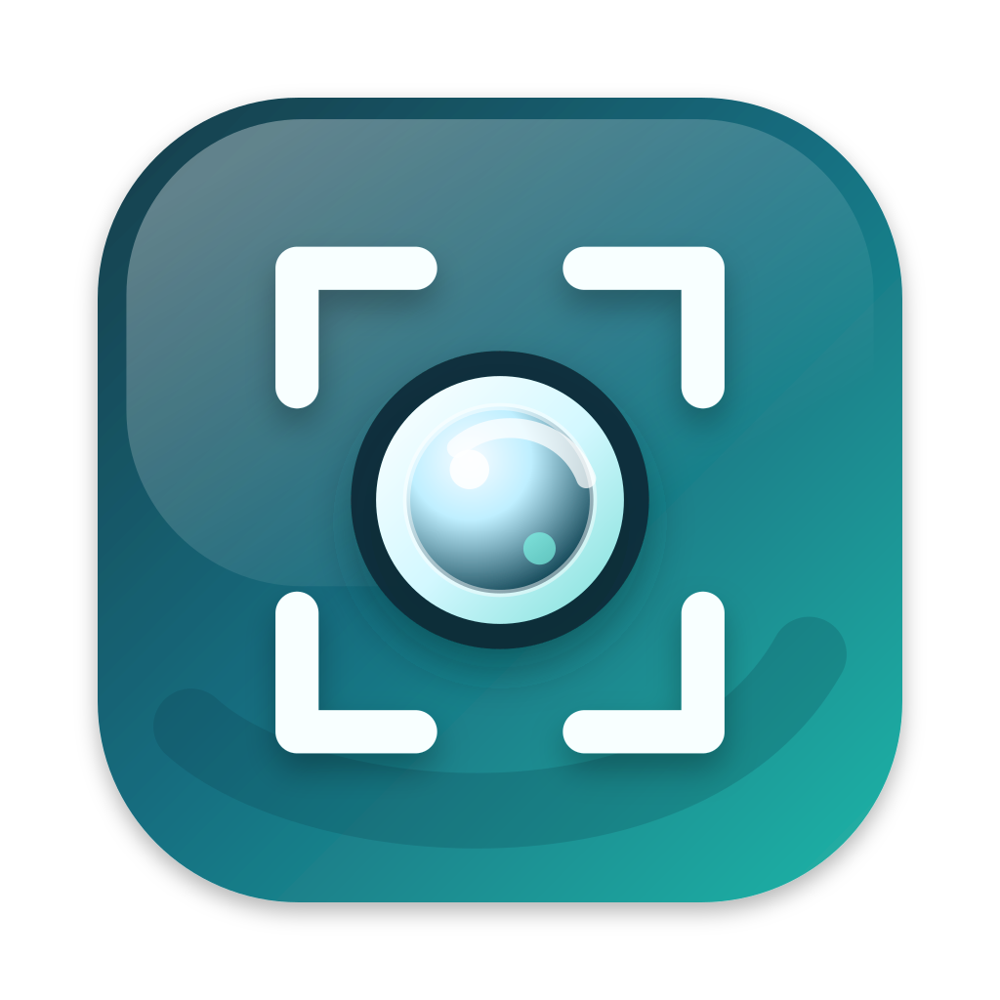

<p align="center">
  
</p>

# Readshot

[](https://github.com/pawanpaudel93/readshot/actions/workflows/test.yml)
[](https://github.com/pawanpaudel93/readshot/actions/workflows/release.yml)
[](LICENSE)

Readshot is a free, offline screenshot tool for macOS with scrolling
capture, OCR, annotation, and searchable capture history.

Website: <https://readshot.pawanpaudel.com.np>

Capture a region, mark it up, copy the image or recognized text, and
find it later by searching the text inside the screenshot.

> **Status:** packaged releases are macOS 14+ only for now. Windows and
> Linux modules exist in the source tree, but they are not wired into
> public release artifacts yet.

## Features

- Region, window, and full-display capture from the menu bar or a
  global hotkey. **Capture Window…** in the menu lights the window under
  the pointer and captures the one you click; give it a shortcut in
  Settings › Capture (none by default). Window capture needs macOS; the
  Windows and Linux source builds capture regions and displays only.
- Scrolling capture — lock a region, scroll the page, get one tall
  stitched image with a live HUD preview.
- Multi-monitor capture with Retina-quality output.
- Annotation editor with shapes (filled, dashed, rounded), curved and
  hand-drawn arrows, pen, highlighter, multi-line text (sizes, pill,
  bold), blur, pixelate, spotlight, stamps, numbered pins, magnifier, crop
  (free, 16:9, 4:3 or square), undo, and redo.
  Hold Shift for squares, circles, and 45° lines.
- An **Image** menu to resize, rotate, and flip a capture, or combine it
  with another capture or an image file.
- A side panel with a **Text** tab (recognized lines to copy, and
  one-click redaction of sensitive text) and a **Beautify** tab
  (background, padding, rounded corners, shadow, canvas size, and
  presets).
- Offline OCR via Apple Vision with layout-aware copied text and a
  choice of recognition languages.
- Searchable capture history with open, reveal, copy, pin, and delete
  actions. Deleting is permanent (not the Trash). A redacted capture whose
  redactions can't all be accounted for keeps no text, and neither does
  a redacted capture on Windows or Linux (their OCR gives no word
  positions to mask by); History says "Text hidden" for it.
- Pin captures as always-on-top reference windows.
- In-app updates via "Check for Updates…" in the menu bar.
- Clean uninstall from Settings, `readshot uninstall`, or the installer
  script — including the login item, CLI links, and permission.
- Scriptable CLI with interactive capture, clipboard output, OCR,
  delay timers, image formats, and bundled MCP server for AI-agent
  workflows.

## Install

Requires macOS 14 Sonoma or newer.

```bash
curl -fsSL https://readshot.pawanpaudel.com.np/install.sh | bash
```

The installer downloads the latest matching DMG, verifies it, installs
`Readshot.app` into `/Applications`, and links `readshot` plus
`readshot-mcp` into `~/.local/bin`.

Manual DMG, first-launch, and uninstall details are in
[docs/INSTALL.md](docs/INSTALL.md).

To uninstall, use **Settings → Uninstall Readshot…**, or run
`readshot uninstall` (add `--purge` to also delete history and
preferences).

## Usage

Launch Readshot from Applications, then click the menu-bar icon to
capture (right-click it for the menu; on Linux it always opens the menu),
or press the default shortcut:

```text
Command + Shift + X
```

CLI examples:

```bash
readshot --help
readshot list-displays
readshot list-windows
readshot capture --interactive --output capture.png
readshot capture --interactive --output capture.png --json
readshot capture-window --window 11474 --clipboard
readshot capture-text --interactive --clipboard
readshot ocr --input capture.png --json
readshot mcp-config
readshot completions zsh
```

For AI-agent hosts, use the bundled MCP command:

```text
readshot-mcp
```

See [docs/MCP.md](docs/MCP.md) for Claude Desktop, Cursor, OpenAI
desktop, Codex CLI, and custom-client examples.
See [docs/CLI.md](docs/CLI.md) for the full command-line workflow
reference.

## Accessibility

Readshot's graphical interface is built on the iced 0.14 UI toolkit,
which does not yet expose an accessibility tree. As a result, screen
readers such as VoiceOver cannot read the app's buttons, menus, or
editor controls. This is a toolkit limitation rather than a design
choice, and it should improve as iced's accessibility support matures.

Every capture and OCR feature is also available from the command line,
which does work with screen readers:

```bash
readshot capture --interactive --output capture.png   # capture a region to a file
readshot capture-text --interactive --clipboard       # capture a region and copy its text
readshot ocr --input capture.png --output text.txt    # OCR an existing image
```

See [docs/CLI.md](docs/CLI.md) for the complete command reference.

Inside the GUI, keyboard shortcuts cover the main workflows:

- **Capture overlay:** drag to select a region, or press an arrow key to
  start a centred one; `↵` captures the full display; `esc` cancels.
  With a selection: `⌘C` / `⇧⌘C` / `⌘S` / `⌘P` / `⌘R` copy image / copy
  text / save / pin / start a scrolling capture, the arrow keys nudge it and
  `⌥` + arrow keys resize it from its bottom-right corner (`⇧` ×10).
- **Window picker (Capture Window…):** `Tab` / `⇧Tab` or the arrow keys
  move between the windows on that display, `↵` or `Space` captures the
  lit one, `esc` cancels.
- **Editor tools:** `V` select, `R` rectangle, `O` ellipse, `L` line,
  `A` arrow, `P` pen, `H` highlighter, `T` text, `B` blur, `X` pixelate,
  `S` spotlight, `N` numbered pin, `E` stamp, `M` magnifier (drag over what to enlarge; drag the bubble anywhere), `C` crop (Free / 16:9 / 4:3 / Square in the options bar; `↵` applies,
  `esc` cancels). `I` picks a color
  from the image (eyedropper). Arrow keys nudge the selection (hold `⇧` for
  larger steps), `⌫` removes it, `esc` deselects (during a drag, `esc`
  cancels only the drag). `Tab` / `⇧Tab` select the next / previous
  annotation; `⌥` + arrow keys resize the selection from its bottom-right
  corner (a selected magnifier moves only its bubble). Pressing `C` starts a
  crop area you can move with the arrow keys and size with `⌥` + arrows.
  `1`–`9` set the line width, `[` / `]` make it one step thinner / thicker
  (for text, the text size), `,` / `.` cycle through the colors, and `↵`
  edits the selected text annotation.
- **Editor actions:** `⌘C` copy image, `⇧⌘C` copy all text (the side panel's Text tab also copies selected lines), `⌘S` save,
  `⌘P` pin, `⌥⌘P` show or hide the side panel, `⌘Z` / `⇧⌘Z` undo and
  redo, `⌘[` / `⌘]` rotate left / right, `⇧⌘H` / `⇧⌘V` flip horizontally /
  vertically, `⌥⌘I` resize (focus starts in Width; `Tab` moves between the
  fields, `⌥P` switches px / %, `⌥L` locks the aspect), `⇧⌘I` opens the Image
  menu (`↑` / `↓` choose a row, `↵` runs it; `-` / `+` change the gap and
  `,` / `.` the alignment of a combined image). The title bar's
  **Image** menu resizes, rotates and flips the capture, and combines it
  with another capture (Add Capture Below / Beside) or an image file; gap
  and alignment are adjustable, and `⌘Z` removes an added part. `⌘W` closes; with unsaved
  edits the first press only warns; press again to discard, or click
  Keep Editing (the warning waits for your answer). Anything that takes
  the warning down without discarding backs out of it, so the next `⌘W`
  warns again.
- **Editor keyboard focus:** `⌃Tab` / `F6` move the keyboard between the
  canvas, the options bar and the side panel (`⌃⇧Tab` / `⇧F6` go back);
  `⌥⌘T` / `⌥⌘B` open the side panel's Text / Beautify tab. Inside the bar or
  the panel, `Tab` / `⇧Tab` (or `↓` / `↑`) move between controls, `←` / `→`
  change the focused value (`⇧` for steps of 10 on sliders), `↵` or `Space`
  press it, and `esc` returns to the canvas. In the Text tab's line list,
  `↑` / `↓` move between lines (`⇧` extends the selection), `Space` selects,
  `↵` or `⌘C` copies and `R` redacts the line. A ring marks the focused
  control. On Windows and Linux, `Ctrl` replaces `⌘` and `Alt` replaces `⌥`,
  except the `⌥⌘` chords: there they are `Ctrl+Shift` (`Ctrl+Shift+P` panel,
  `Ctrl+Shift+R` resize, `Ctrl+Shift+T` / `Ctrl+Shift+B` panel tabs), because
  `Ctrl+Alt` is AltGr on many keyboards and `Ctrl+Alt+T` opens a terminal.
  Editor chords never fire while a text field has the caret. `Tab` in the
  Color popover applies a typed hex (as `↵` does) and returns to the bar;
  `esc` cancels it.
- **Any Readshot window:** `⌘Y` opens History and `⌘,` opens Settings.
  These work only while a Readshot window is active; the capture shortcut
  is the only one Readshot registers system-wide, so other apps keep their
  own `⌘Y` and `⌘,`.
- **History window:** `↑` / `↓` move between captures (moving past the
  last one shown loads more), `↵` opens the selected one, `⌘C` copies
  its image and `⇧⌘C` its text, `⌘P` pins it, `⌥⌘R` reveals it in Finder,
  `⌘⌫` deletes it, `⌥⇧⌘C` copies the text of every visible capture,
  `⇧⌘⌫` clears all (press twice to confirm; both deletions are permanent), `⌘F` focuses the search, and
  `esc` cancels an armed prompt or clears the search. On Windows and Linux,
  Reveal is `Ctrl+Shift+R` and Copy Visible Text is `Ctrl+Shift+A`.
- **Settings window:** `⌘1`–`⌘7` switch panes; `esc` / `⌘W` close; `⌘L`
  toggles launch-at-login and `⌘D` toggles debug logging; `⌘R` and `⌘F`
  cycle retention and the default save format; `⌘K` records a new capture
  shortcut (the window-capture shortcut has its own Record and Clear
  buttons on the Capture pane); `⇧⌘R` resets and `⇧⌘U` uninstalls (press twice to confirm).
  Each shortcut also brings up the pane its setting lives on, and the pane
  title says what changed. `Tab` / `⇧Tab` move a focus ring through the
  pane's controls (buttons, pickers, checkboxes, the filename field), `Space`
  or `↵` presses the focused one and `←` / `→` change a picker. `esc`
  steps back one level: out of the filename field, then off the ring, then
  closes the window.
- **Scrolling-capture window:** `esc` stops and stitches the session;
  `⇧esc` or `⌘.` discards it (press twice to confirm, or click Keep Going,
  Resume in a narrow window, to carry on capturing; the confirmation waits for your answer). While a
  session runs, `esc` and `⇧esc` work from any app, so you don't have to
  click the window first. This reserves `esc` and `⇧esc` system-wide for
  the length of the session: other apps don't receive them until it stops
  or is discarded. They are registered only while frames are being
  captured and released the moment that ends, whichever way it ends (Stop,
  the stitch finishing or failing, Discard, or the capture window
  closing). Scrolling on after the first Discard press counts as Keep
  Going, except for the trackpad's momentum in the first 1.5 seconds.
- **Pinned windows:** `esc` / `⌘W` close, `L` lock, `-` / `+` adjust opacity,
  arrow keys move the window by 1 pixel (hold `⇧` for 10).
- **Welcome screen:** `↵` triggers the primary action (Allow / Open System
  Settings / Capture); `⌘R` restarts Readshot and `⇧⌘R` resets the Screen
  Recording permission when those buttons are shown.

Readshot also respects the system Reduce Motion setting, dropping non-essential
animation when it is enabled.

## Development

Build from source without installing:

```bash
cargo run --bin readshot
```

For local app testing:

```bash
packaging/macos/install-local.sh
```

Run checks:

```bash
cargo fmt --all -- --check
cargo nextest run --workspace
cargo clippy --workspace --all-targets -- -D warnings
```

Useful docs:

- [AGENTS.md](AGENTS.md) — contributor orientation and repo layout.
- [docs/INSTALL.md](docs/INSTALL.md) — install paths and first-launch notes.
- [docs/CLI.md](docs/CLI.md) — command-line capture and OCR recipes.
- [docs/MCP.md](docs/MCP.md) — MCP server setup.
- [docs/ROADMAP.md](docs/ROADMAP.md) — planned screenshot workflow improvements.
- [docs/RELEASING.md](docs/RELEASING.md) — release runbook.

## License

[MIT](LICENSE)
